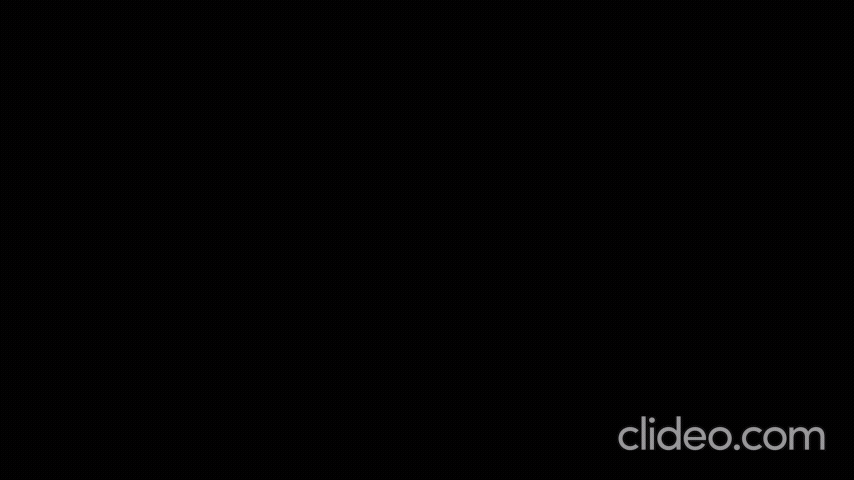

# ascii-cam

Real-time webcam to ASCII art renderer in C++ using OpenCV. Each frame is split into pixel tiles, and every tile is turned into one character in your terminal, while a normal OpenCV window shows the original camera feed next to it.



## Features

- Live webcam capture rendered as ASCII in the terminal
- Automatic camera detection (tries device indexes 0-8)
- Three tile sizes to trade detail for terminal space
- Seven-level character ramp: ` ` `-` `*` `x` `@` `#` `M`
- Hue-dominant shading by default, which gives objects a more 3D look than a flat saturation map
- Live control of hue and saturation weighting while the program runs
- Optional auto-adjust mode that tunes the saturation weight on its own (experimental)
- On-screen display of the current weights and auto-adjust state

## Requirements

- C++17 compiler
- CMake 3.10 or newer
- OpenCV 4.x
- A webcam
- A terminal with ANSI escape code support (see terminal sizes below)

On Debian, Ubuntu and Linux Mint:

```
sudo apt install build-essential cmake libopencv-dev
```

## Build and run

```
mkdir build && cd build
cmake ..
cmake --build .
./ascii_cam
```

On start you are asked to pick a tile size. Type the number and press Enter. After that, keyboard controls go to the OpenCV window, so **click on the "webcam" window to give it focus**.

## Tile sizes and terminal size

The terminal output has one character per tile, plus 4 extra lines for the status and help text. Sizes below are for a 640x480 camera. Use a terminal at least this big (and at least 80 columns wide), or the image will wrap and tear. Zooming the terminal out (Ctrl and minus) helps with the larger grids.

| Option | Tile (w x h px) | Character grid | Minimum terminal |
|---|---|---|---|
| 1 | 9 x 16 | 72 x 30 | 80 x 34 |
| 2 | 5 x 10 | 128 x 48 | 128 x 52 |
| 3 | 3 x 6 | 214 x 80 | 214 x 84 |

A camera with a higher resolution produces a bigger grid, so the terminal needs to be larger to match.

## Controls

Keys work while the OpenCV window is focused.

| Key | Action |
|---|---|
| `y` / `h` | Increase / decrease hue weight |
| `u` / `j` | Increase / decrease saturation weight (also turns auto-adjust off) |
| `a` | Toggle auto-adjust on or off |
| `r` | Reset hue and saturation weights to their defaults |
| `q` or `Esc` | Quit |

Closing the OpenCV window also quits.

## How it works

1. Each frame is converted from BGR to HSV.
2. The frame is split into tiles of the chosen size (edge tiles are averaged over their actual size).
3. Every pixel gets a value from a weighted blend of its hue and saturation. Only the ratio between the two weights matters.
4. The tile average is mapped to one of seven characters, from lightest to densest: ` ` `-` `*` `x` `@` `#` `M`.
5. The whole frame is built as a single string and written once per frame to reduce flicker.

Hue is weighted much higher than saturation by default (hue 1.0, saturation 0.1). Hue shifts between lit and shaded parts of a surface, which gives shading cues and a more 3D look. If you prefer a flatter image, raise the saturation weight with `u` or lower the hue weight with `h`.

### Auto-adjust (experimental)

When on, the program compares how many character changes ("boundaries") appear between consecutive frames and nudges the saturation weight in response. It starts **on**. Because it reacts to movement and camera exposure changes, it can drift the weights away from the default look. Press `a` to turn it off, or `r` to reset the weights. Pressing `u` or `j` turns it off automatically so your manual setting is kept.

## Notes and limitations

- Thresholds and defaults were tuned on one webcam and room. Different cameras and lighting may look different, so use the live controls to adjust.
- Hue is circular (reds sit near both ends of the range), so some colors may speckle.
- Tested on Linux Mint. On Windows, use Windows Terminal so the ANSI escape codes work.
- If no camera is found, the program prints a message and exits.

## Roadmap

- [ ] Fixed character grid with adjustable aspect ratio
- [ ] Ramp stored as a string, with easier ways to add more layers
- [ ] Lookup table for the character mapping
- [ ] Selectable source channel (saturation, brightness, or a blend)
- [ ] Exit cleanly if the camera stops delivering frames

## License

MIT, see the `LICENSE` file.
